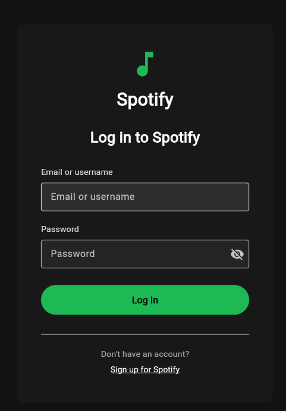
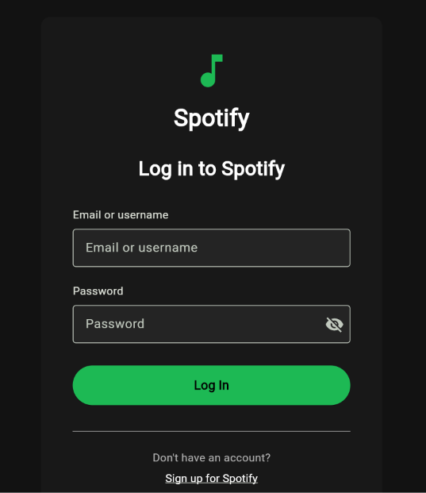
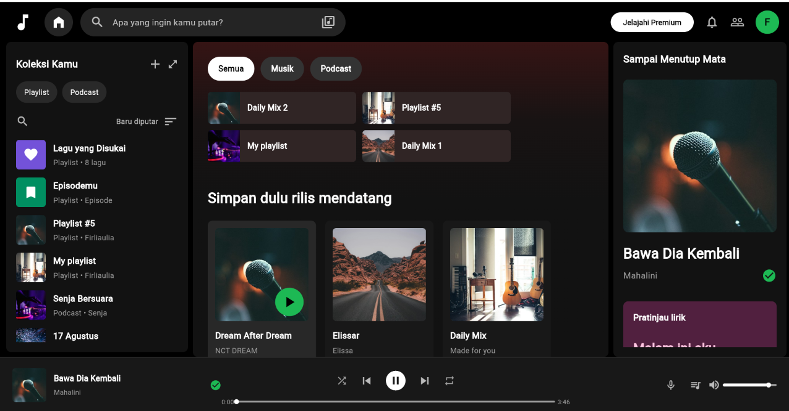

# Spotify Desktop UI – Flutter

Aplikasi desktop pemutar musik dengan tampilan yang terinspirasi dari Spotify, dikembangkan menggunakan **Flutter** dan **Dart**.

Proyek ini dibuat sebagai sarana pembelajaran pengembangan aplikasi desktop, khususnya dalam membangun antarmuka pengguna (UI), penggunaan widget Flutter, serta pengelolaan komponen aplikasi.

## 📌 Tentang Proyek

Spotify Desktop UI merupakan aplikasi prototype yang menghadirkan pengalaman antarmuka pemutar musik dengan desain modern dan dominasi warna gelap.

Aplikasi ini memiliki beberapa bagian utama, seperti sidebar koleksi musik, halaman dashboard, daftar playlist, panel informasi lagu, serta kontrol pemutar musik di bagian bawah.

## ✨ Fitur

- **Dashboard Musik** – Menampilkan halaman utama dengan berbagai rekomendasi musik.
- **Sidebar** – Menampilkan area koleksi playlist dan navigasi.
- **Music Cards** – Menampilkan kartu musik beserta gambar dan informasi lagu.
- **Now Playing Panel** – Menampilkan informasi lagu yang sedang dipilih.
- **Music Player Bar** – Menampilkan kontrol Play, Pause, Next, dan Previous.
- **Shuffle & Repeat** – Tombol pengaturan mode pemutaran.
- **Progress Bar** – Tampilan pengaturan posisi lagu.
- **Volume Control** – Pengaturan volume melalui slider.
- **Dynamic Song Information** – Informasi judul, artis, dan gambar lagu mengikuti lagu yang dipilih.

> Catatan: Proyek ini masih berupa prototype UI. Kontrol pemutar musik belum terhubung dengan layanan streaming atau pemutaran file audio sungguhan.

## 🛠️ Teknologi yang Digunakan

- Flutter
- Dart
- Visual Studio Code
- Material Design
- Git & GitHub

## 📁 Struktur Folder

```text
spotify-desktop/
│
├── lib/
│   ├── main.dart
│   │
│   ├── models/
│   │   └── song.dart
│   │
│   ├── screens/
│   │   ├── login_screen.dart
│   │   ├── register_screen.dart
│   │   └── dashboard_screen.dart
│   │
│   ├── widgets/
│   │   ├── sidebar.dart
│   │   ├── music_card.dart
│   │   ├── player_bar.dart
│   │   └── top_bar.dart
│   │
│   └── utils/
│       └── app_colors.dart
│
├── assets/
│
├── test/
│
├── pubspec.yaml
├── analysis_options.yaml
└── README.md
```

*Struktur di atas merupakan gambaran folder proyek. Sesuaikan dengan file yang benar-benar tersedia di repository.*

## 💻 Persyaratan Sistem

Sebelum menjalankan aplikasi, pastikan perangkat sudah memiliki:

1. Flutter SDK.
2. Dart SDK (termasuk dalam Flutter).
3. Visual Studio Code.
4. Visual Studio dengan workload **Desktop development with C++** untuk menjalankan aplikasi Windows.
5. Git.

Periksa instalasi Flutter dengan perintah:

```bash
flutter doctor
```

## 🚀 Cara Menjalankan Proyek

### 1. Clone Repository

Buka terminal dan jalankan:

```bash
git clone https://github.com/USERNAME/REPOSITORY-NAME.git
```

Ganti `USERNAME` dan `REPOSITORY-NAME` dengan alamat repository GitHub milikmu.

### 2. Masuk ke Folder Proyek

```bash
cd REPOSITORY-NAME
```

### 3. Install Dependencies

Jalankan perintah:

```bash
flutter pub get
```

### 4. Periksa Kode

```bash
flutter analyze
```

### 5. Jalankan Aplikasi

Untuk menjalankan aplikasi pada Windows Desktop:

```bash
flutter run -d windows
```

Pastikan dukungan Windows Desktop Flutter dan toolchain Visual Studio sudah terpasang.

## 🎨 Konsep Desain

Aplikasi menggunakan konsep desain dark mode dengan beberapa elemen antarmuka, antara lain:

- Background berwarna hitam dan abu-abu gelap.
- Aksen warna hijau yang terinspirasi dari identitas visual Spotify.
- Kartu playlist dengan gambar sampul.
- Layout dashboard dengan sidebar, konten utama, dan panel Now Playing.
- Pemutar musik pada bagian bawah aplikasi.

## 🔧 Pengembangan Selanjutnya

Beberapa fitur yang berpotensi dikembangkan:

- Integrasi pemutar audio sungguhan.
- Integrasi database untuk menyimpan playlist.
- Fitur pencarian musik.
- Sistem autentikasi pengguna.
- Pengelolaan playlist dan koleksi lagu.
- Integrasi API musik.

## 📚 Tujuan Pembelajaran

Proyek ini dikembangkan untuk mempelajari:

- Penggunaan widget Flutter.
- Pembuatan layout aplikasi desktop.
- Penggunaan StatefulWidget dan StatelessWidget.
- Pengelolaan data lagu menggunakan model.
- Penggunaan ValueNotifier untuk memperbarui informasi lagu.
- Pemisahan kode berdasarkan fungsi dan komponen.

## 📄 Lisensi dan Disclaimer

Proyek ini dibuat untuk tujuan edukasi dan pembelajaran.

Spotify merupakan merek dagang milik Spotify AB. Proyek ini bukan aplikasi resmi Spotify, tidak berafiliasi dengan Spotify, dan tidak menyediakan layanan streaming musik resmi.

---

## Tangkapan Layar (Screenshots)

### 1. Halaman Login & Registrasi
| Halaman Login | Halaman Register |
| :---: | :---: |
|  |  |

### 2. Dashboard 
| Dashboard Beranda | Profil Pengguna |
| :---: | :---: |
|  